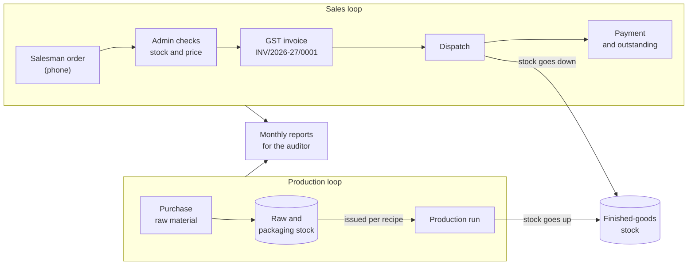
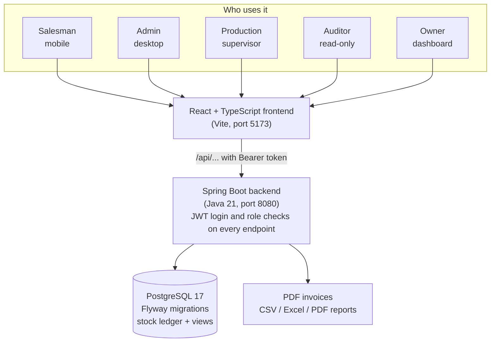
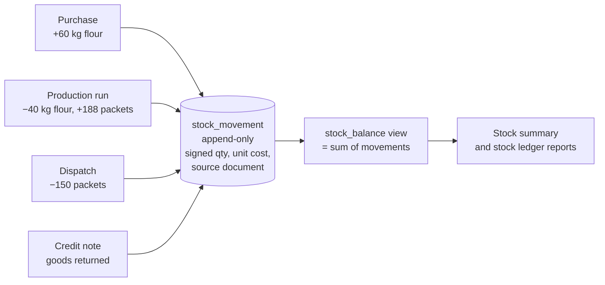
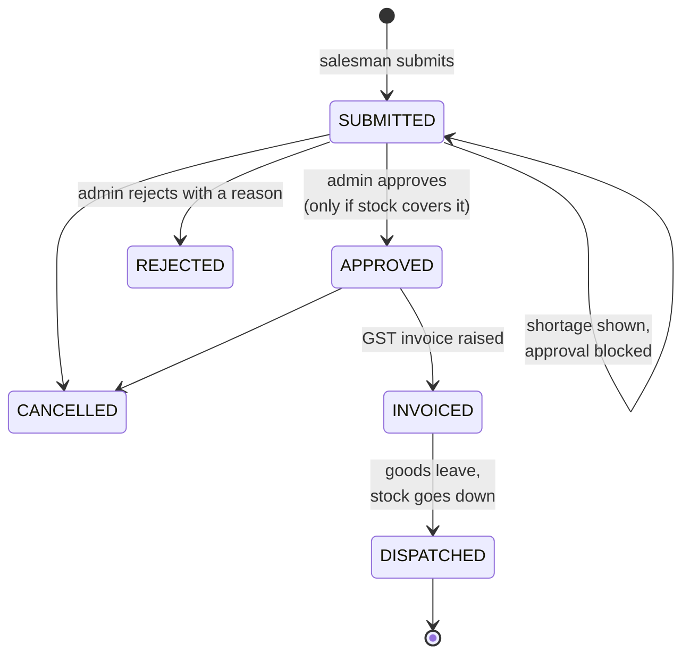
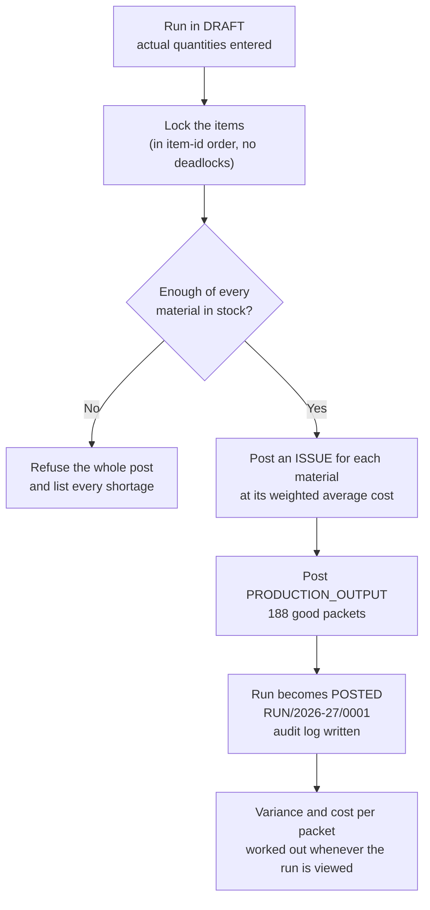
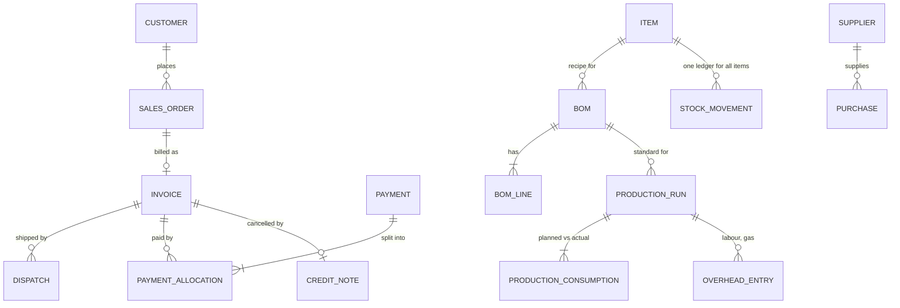

# Order-to-Audit System

**A working prototype for a small South Indian snack factory. It follows one transaction from the salesman's order all the way to the auditor's monthly report.**

Shortlisting submission for the NIT Tiruchirappalli, Centre for Digital Infrastructure, Winter Internship 2026. Individual work by Tharun.

Demo video: [LINK]

> **Short version for evaluators**
> - Every number in the section 5 benchmark matches the brief. Each one is checked by an automated test (see [Benchmark results](#benchmark-results)).
> - Cost per packet is **₹31.14** (weighted average cost, with labour and gas charged to the run).
> - One command starts the database, one starts the backend and one starts the frontend (not yet one Docker command for the whole stack). Test logins for all five roles are [below](#test-logins).
> - The whole benchmark can be walked through in the browser: login, salesman ordering on a phone, admin approval with the stock check, GST invoices with PDF download and sharing, dispatch, payments with outstanding and ageing, purchases, production runs with variances and cost per packet, and stock balances with the ledger.
> - Master data (customers, suppliers, items, versioned recipes) can be created and edited through the API, which is tested; the screens for it, and the report and dashboard screens, are still to come. Reports are exported through the API as CSV, Excel or PDF ([known gaps](#known-gaps)).

---

## Contents

1. [What problem this solves](#what-problem-this-solves)
2. [How it works, in pictures](#how-it-works-in-pictures)
3. [Tech stack and why](#tech-stack-and-why)
4. [Installing and running it](#installing-and-running-it)
5. [Test logins](#test-logins)
6. [Using the app](#using-the-app)
7. [Benchmark results](#benchmark-results)
8. [Features against the brief's tiers](#features-against-the-briefs-tiers)
9. [Tests](#tests)
10. [Project structure](#project-structure)
11. [Assumptions](#assumptions)
12. [Known gaps](#known-gaps)
13. [Further reading](#further-reading)

---

## What problem this solves

Today the factory runs on phone calls, WhatsApp messages, a billing tool, a stock notebook and paper production sheets. The same order gets typed in three times, stock never matches the books, nobody knows what a packet really costs, and the month end is a scramble.

This system lets each transaction be **entered once, by the person who does it**: the salesman, the admin or the production supervisor. Stock, costing and the monthly reports then follow from that single entry without any re-typing.

The interesting part is the **production loop**. A recipe (bill of materials) says how much flour, oil and spice one batch should use. The system compares that with what the floor actually used, flags anything more than 3% off, and works out the real cost per packet.

---

## How it works, in pictures

### 1. The two loops meet at finished-goods stock



### 2. The parts of the system



### 3. Stock is a ledger, never a number someone types over

There is no "current stock" column anywhere. Every change to stock is a new row in one table, `stock_movement`, and that row says which document caused it. The balance you see is simply the sum of those rows (the `stock_balance` view), so it cannot drift from the history.



The database itself refuses bad data, even if the code had a bug:
- a movement's sign has to match its type (a purchase can only add stock),
- the same document cannot post the same item twice (a unique key on source document + item + type),
- an invoice's total has to equal taxable value + tax, and CGST/SGST and IGST can never both appear.

### 4. Life of a sales order



Approving an order **reserves** stock but does not move it. Stock only moves when the goods physically leave (dispatch). That is how Distributor B's 120-packet order is shown as **32 short**: 88 packets are on hand, and the system also says one more batch is needed.

### 5. Posting a production run (one transaction: all or nothing)



### 6. Main tables (simplified)



Raw materials, packaging and finished goods all sit in one `item` table, so they share one ledger. The full diagram with columns is in the [design note](docs/design-note/design-note.md).

---

## Tech stack and why

| Layer | Choice |
| --- | --- |
| Backend | Spring Boot 4.2, Java 21, Spring Security (JWT), Spring Data JPA |
| Database | PostgreSQL 17, schema managed by Flyway migrations |
| Frontend | React 19, TypeScript, Vite, Tailwind CSS, TanStack Query |
| Documents | HTML-to-PDF for invoices and reports, Apache POI for Excel |
| Tests | JUnit 5 + Testcontainers (a real Postgres), Vitest + Testing Library |
| Running it | Docker Compose for the database, GitHub Actions runs the tests on every push |

**Why this stack.** Posting a production run has to change stock, costing and the audit log together, or not at all. A single Spring Boot application talking to one PostgreSQL database gives me that in one `@Transactional` method, and Postgres can enforce the ledger rules (check constraints, unique keys, row locks) as well. Money and quantities are `BigDecimal` in Java and `NUMERIC` in the database, so nothing drifts through floating-point rounding. React gives one codebase for the salesman's phone screen and the admin's desktop screen.

---

## Installing and running it

### What you need first

| Tool | Version | Check with |
| --- | --- | --- |
| Git | any recent | `git --version` |
| Java JDK | **21 or newer** | `java -version` |
| Docker Desktop | running | `docker --version` |
| Node.js | **22 LTS** (20.19 or newer) | `node -v` |

You do **not** need to install Maven or PostgreSQL. The Maven wrapper (`mvnw`) downloads Maven, and Docker runs Postgres.

The commands below are for **Windows PowerShell**. On macOS or Linux, use `./mvnw` instead of `.\mvnw.cmd` and `export NAME=value` instead of `$env:NAME = "value"`.

### Step 1: get the code

```powershell
git clone <this-repository-url>
cd <repository-folder>
```

### Step 2: start the database

Open Docker Desktop and wait until it says it is running. Then, from the repository root:

```powershell
docker compose up -d
```

This starts PostgreSQL 17 on port **5432** (database `order_to_audit`, user `ota`, password `ota`). Its data is kept in a Docker volume, so it survives a restart.

### Step 3: start the backend

```powershell
cd backend
$env:OTA_BUSINESS_DATE = "2026-11-28"    # optional, see the note below
.\mvnw.cmd spring-boot:run
```

The first run takes a few minutes while Maven downloads its libraries. When you see `Started OrderToAuditApplication`, the API is ready at **http://localhost:8080**.

On first start, Flyway builds the whole schema and loads the benchmark master data: the five items, the Murukku recipe, Retailer A and Distributor B, the opening stock and the test users.

> **Why set the business date?** The benchmark happens in November 2026. With `OTA_BUSINESS_DATE` set, the app treats that date as "today", so new orders, the default report period and the dashboard all fall in the benchmark month whatever your computer's clock says. The app logs a warning at startup to remind you the date is fixed. Leave it out to use the real date.

### Step 4: start the frontend

Open a **second** terminal:

```powershell
cd frontend
npm install
npm run dev
```

Open **http://localhost:5173** and log in with one of the [test logins](#test-logins). The Vite dev server passes every `/api` call to the backend on port 8080, so there is nothing else to configure.

**On a real phone:** run `npm run dev -- --host` instead. Vite prints a network address such as `http://192.168.1.20:5173`. Open it on a phone connected to the same Wi-Fi and log in as `salesman_a`.

### Starting again from a clean database

To get a database that is back to the seed data only (handy before recording a demo, so the documents start at `SO/2026-27/0001`, `INV/2026-27/0001` and so on):

```powershell
docker compose down -v     # deletes the database volume and all data in it
docker compose up -d
```

Then start the backend again. It rebuilds the schema and the seed.

### Running from an IDE

Set the active profile to `dev`, for example with the VM option `-Dspring.profiles.active=dev`. The app deliberately has **no default profile**: without one there is no signing key and no test data, so it refuses to start instead of quietly using demo settings. `spring-boot:run` already picks `dev` for you.

### If something goes wrong

| What you see | What to do |
| --- | --- |
| `Connection refused` to port 5432 | Docker isn't running, or `docker compose up -d` wasn't run. Check with `docker ps`. |
| Port 5432 already in use | Another PostgreSQL is running locally. Stop it, or change the port mapping in `docker-compose.yml` and set `DB_URL`. |
| Backend stops at startup with a JWT secret error | No profile is active. Use `spring-boot:run`, or set the `dev` profile in your IDE. |
| Tests fail with "Could not find a valid Docker environment" | The tests start their own Postgres through Docker. Start Docker Desktop first. |
| Login page says it can't reach the server | The backend isn't running on port 8080. |

---

## Test logins

These users exist only in the `dev` and `test` profiles. They are dummy credentials and are never loaded anywhere else.

| Role | Username | Password | Lands on |
| --- | --- | --- | --- |
| Salesman (Retailer A) | `salesman_a` | `Sales@123` | New order (mobile layout) |
| Salesman (Distributor B) | `salesman_b` | `Sales@123` | New order (mobile layout) |
| Factory admin | `admin` | `Admin@123` | Orders |
| Production supervisor | `production` | `Prod@123` | Production runs |
| Auditor (read-only) | `auditor` | `Audit@123` | Reports (no report screen yet; the other pages open read-only) |
| Owner (read-only) | `owner` | `Owner@123` | Reports (no report screen yet; the other pages open read-only) |

Each role sees only its own screens and endpoints. Any other request gets HTTP 403. A salesman sees only their own customers and orders, and asking for someone else's order returns 404, so it doesn't even reveal that the order exists.

---

## Using the app

### In the browser

The benchmark in order, each step as the right user:

1. **Production:** log in as `production`. *Purchases → Record purchase*: 60 kg flour at ₹45 from Sample Flour Mills. *Stock* then shows flour 160 kg at ₹43.125.
2. **Production:** *Production runs → New run* for Murukku 200 g, 1 batch. Enter the actuals (oil in L or ml): flour 40 kg, oil 10.5 L, spice 1.2 kg, pouches 194 with 6 damaged, cartons 9, good output 188. *Post run* first lists what leaves and enters stock. The posted run shows oil **+5.00% Flagged** and yield **−6.00% Flagged**.
3. **Salesman (on a phone):** log in as `salesman_a`, pick Retailer A, enter 150 packets and submit. The estimate shows ₹7,875.00. Under *My orders* the salesman follows its status.
4. **Admin:** log in as `admin`. Open the order to see the stock check, approve it and create the invoice. On the invoice: *Download PDF*, *Share invoice* (phone share sheet, or a WhatsApp link on a desktop), *Record dispatch*, and *Cancel invoice* (with a reason; issues a credit note). *Stock* then shows 88 packets.
5. **Salesman B:** 120 packets for Distributor B (IGST). The admin sees **Short by 32** and can only approve the 88 available.
6. **Admin:** *Payments → Record payment*: ₹4,000 from Retailer A, allocated to the invoice (the allocation must equal the amount). *Customer outstanding* shows ₹3,875.00 with ageing.
7. **Production:** on the posted run, add labour ₹1,200 and gas/power ₹600. The cost block shows **₹31.14 per packet**.

Auditor and owner can open every page read-only, with all actions hidden. The stock ledger links each movement to its run, invoice or purchase.

### Through the API (masters, reports and the dashboard)

Every endpoint is under `/api` and needs a token from the login call. In PowerShell:

```powershell
# Log in and keep the token
$login = Invoke-RestMethod -Method Post -Uri http://localhost:8080/api/auth/login `
         -ContentType "application/json" `
         -Body '{"username":"auditor","password":"Audit@123"}'
$auth = @{ Authorization = "Bearer $($login.token)" }

# Stock balances as JSON
Invoke-RestMethod -Uri http://localhost:8080/api/inventory/balances -Headers $auth

# This month's stock summary as an Excel file
Invoke-WebRequest -Uri "http://localhost:8080/api/reports/stock-summary?from=2026-11-01&to=2026-11-30&format=xlsx" `
                  -Headers $auth -OutFile stock-summary.xlsx
```

Main endpoints:

| Area | Endpoints |
| --- | --- |
| Login | `POST /api/auth/login`, `GET /api/auth/me` |
| Masters | `GET /api/products`; `GET`/`POST /api/customers`, `/api/suppliers`, `/api/items` (`?status=active\|inactive\|all`), then `PUT /{id or code}`, `POST /{…}/deactivate`, `/reactivate`; `GET /api/salesmen` |
| Recipes (BOMs) | `GET /api/boms?productCode=`, `POST /api/boms` (new inactive version, optional `copyIngredientsFrom`), `POST /api/boms/{id}/activate` |
| Orders | `POST /api/orders`, `GET /api/orders/{id}/stock-check`, `PUT /{id}/lines`, `POST /{id}/approve`, `/reject`, `/cancel` |
| Invoices | `GET`/`POST /api/invoices`, `GET /api/invoices/{id}/pdf`, `POST /{id}/cancel` (issues a credit note) |
| Dispatch and payments | `POST /api/dispatches`, `GET`/`POST /api/payments`, `GET /api/customers/{id}/outstanding` |
| Purchases | `POST /api/purchases`, `GET /api/purchases` |
| Production | `GET`/`POST /api/production-runs`, `PUT /{id}/actuals`, `POST /{id}/post`, `/cancel`, `/overheads` |
| Stock | `GET /api/inventory/balances`, `GET /api/inventory/ledger` |
| Reports | `GET /api/reports/{report}?from=&to=&format=json\|csv\|xlsx\|pdf` |
| Dashboard | `GET /api/dashboard` |

Reports available: `sales-register`, `gst-summary`, `purchase-register`, `stock-summary`, `stock-ledger?itemCode=`, `production-report`, `collections`, `outstanding` (with ageing), and `my-sales` for a salesman.

---

## Benchmark results

The whole section 5 scenario runs as automated tests in [backend/src/test/java/com/ordertoaudit/benchmark/](backend/src/test/java/com/ordertoaudit/benchmark/). To run just those:

```powershell
cd backend
.\mvnw.cmd test "-Dtest=*BenchmarkTest"
```

| Check | Brief expects | This system | |
| --- | --- | --- | :-: |
| Flour closing balance | 120 kg | 120 kg | ✔ |
| Oil closing balance | 19.5 L | 19.5 L | ✔ |
| Pouches closing balance | 306 | 306 | ✔ |
| Finished goods after the run | 238 | 238 | ✔ |
| Finished goods after Retailer A dispatch | 88 | 88 | ✔ |
| Yield variance | −6%, flagged | −6.00%, flagged | ✔ |
| Oil consumption variance | +5%, flagged | +5.00%, flagged | ✔ |
| Retailer A invoice | ₹7,500 + ₹187.50 CGST + ₹187.50 SGST = ₹7,875 | ₹7,875.00, `INV/2026-27/0001` | ✔ |
| Retailer A outstanding | ₹3,875 | ₹3,875.00 | ✔ |
| Distributor B order | Shortage 32 flagged, IGST if invoiced | Shortage 32, approval blocked; IGST ₹220.00 if approved for the 88 available | ✔ |
| Cost per packet | Your own figure | **₹31.14** (₹31.1436) | see below |

### How the cost per packet is worked out

**Valuation method: weighted average cost.** Flour and oil are bulk stock poured into the same bin, so old and new lots aren't kept apart. A weighted average reflects that and is easy for an auditor to follow. After the purchase, flour costs (100 × ₹42 + 60 × ₹45) ÷ 160 = **₹43.125 per kg**.

**Overhead rule.** Labour and gas entered against a run are charged to that run. Monthly overheads that don't belong to one run are shared between that month's runs in proportion to good output in kg, which stays fair if a 500 g pack is added later.

| Component | Calculation | ₹ |
| --- | --- | ---: |
| Flour | 40 kg × 43.125 | 1,725.00 |
| Cooking oil | 10.5 L × 140 | 1,470.00 |
| Spice mix | 1.2 kg × 200 | 240.00 |
| Pouches (188 used + 6 damaged) | 194 × 2.50 | 485.00 |
| Cartons | 9 × 15 | 135.00 |
| Labour + gas/power | 1,200 + 600 | 1,800.00 |
| **Total for the run** | | **5,855.00** |
| **Cost per packet** | 5,855.00 ÷ 188 good packets | **31.1436, shown as 31.14** |
| Margin against ₹50 selling price | 50.00 − 31.1436 | ₹18.86 per packet (37.71%) |

For comparison, FIFO would give ₹30.90 and last purchase price ₹31.54.

### Where my numbers go beyond the brief (and why)

- **An extra variance flag on pouches (+3.19%).** 188 good packets needed 188 pouches, but 194 were used because 6 were damaged. The brief only expects the yield and oil flags, but hidden packaging wastage is exactly the problem the client described, so I flag it too. All the brief's numbers are unchanged.
- **Cartons show 0% variance, not −4.26%.** 188 packets fill 9 full cartons with 8 loose packets. A fraction of a carton is never really used, so the standard is taken as whole cartons: 188 ÷ 20, rounded down, is 9.
- **Finished goods go into stock at material + packaging cost (₹21.57 per packet), without overheads.** The benchmark adds labour and gas in step 8, *after* the run is posted, and a posted ledger is never edited. So overheads appear in the costing report (the ₹31.14), not in stock value. This is a documented simplification: Indian accounting standard AS 2 would include conversion costs in inventory.
- **The opening 50 packets are valued at ₹30.00 each.** The brief gives no cost for them, but dispatches need a cost. This affects stock value only, not any quantity, invoice, outstanding or cost-per-packet figure.

---

## Features against the brief's tiers

✔ built and tested, with a screen · ◐ built and tested in the backend (API), screen still to come · ✗ not built yet

### Must have

| Requirement | Status | Notes |
| --- | :-: | --- |
| Login with at least three roles | ✔ | Five roles, JWT, role checks on every endpoint, and a test that fails if any endpoint is left unprotected |
| Product, customer, raw-material and BOM masters | ◐ | Create, edit and deactivate customers, suppliers and items; versioned recipes with copy-ingredients-from and activation; all audited and tested through the API. Screens still to come |
| Mobile-friendly order entry and admin approval | ✔ | Phone-first salesman screen, admin approval with stock check, quantity and price edits |
| GST invoice as PDF | ✔ | GSTIN, HSN, CGST/SGST or IGST by place of supply, amount in words, numbering by financial year. Download and share (WhatsApp) from the invoice screen; cancel with a credit note |
| Production run updates raw-material and finished-goods stock | ✔ | New run, actuals in any allowed unit, post with a confirmation of the stock movements; shortages listed per item |
| Planned vs actual consumption and yield, with variance | ✔ | Per item and for yield, with a 3% tolerance stored in the company settings; flags shown as the percentage and the word |
| Stock summary and stock ledger | ✔ | Balances by group and a ledger screen linking each movement to its source document; the exported report refuses to print if opening + in − out ≠ closing |
| Sales register and stock report, exportable to Excel/CSV | ◐ | CSV, Excel and PDF for every report through the API; no report screen yet |

### Should have

| Requirement | Status | Notes |
| --- | :-: | --- |
| Purchases and supplier records | ✔ | Purchase screen with a unit selector (for example g → kg), weighted average updated on each receipt. Supplier create/edit is API only |
| Payments, outstanding and ageing | ✔ | Payment allocated to invoices (must equal the amount); ageing in 0–30 / 31–60 / 61–90 / 90+ day buckets; outstanding as of any past date |
| Cost per packet with overheads | ✔ | Overheads entered on the run screen, cost block with margin. Monthly overheads shared by kg of output in the report |
| GST summary report | ◐ | Shaped like GSTR-1 (B2B, B2CS, credit notes, HSN summary) and GSTR-3B 3.1(a) |
| Variance alerts beyond a tolerance | ✔ | Flags on the run and the runs list; also in the production report and the dashboard API |
| Owner dashboard | ◐ | Today's orders, stock levels, variance alerts, cost per packet, top 5 outstanding customers (API only, no screen yet) |

### Stretch goals

| Goal | Status | Notes |
| --- | :-: | --- |
| Offline orders with sync | ◐ | Each order carries an ID made on the phone, so re-sending after a network drop never creates a duplicate. Automatic background sync isn't built yet |
| Production planning from pending orders | ◐ | A shortage shows how many batches are needed ("1 batch") |
| Reorder levels and low-stock alerts | ◐ | Optional reorder level per item, flagged on the dashboard |
| Batch and expiry, GPS, Tally export, e-Invoice, Tamil UI | ✗ | Left for later, as the brief suggests: must-haves first |

### Things the brief asks for that run through everything

- **No floats for money.** `BigDecimal` and `NUMERIC` everywhere, rounded half-up.
- **Traceability.** Every stock movement names its source: purchase, production run, dispatch, credit note, adjustment or opening stock.
- **Audit trail.** Every create, edit, post, cancel and login (including failed ones) writes an `audit_log` row with user and time. Posted invoices are cancelled with a credit note, never deleted.
- **Gap-free document numbers** per financial year: `SO/`, `INV/`, `CN/`, `RUN/`, `DC/2026-27/0001`.
- **Unit conversion.** g ↔ kg, ml ↔ L, and cartons ↔ packets for each item. Everything is stored in the item's base unit.

---

## Tests

```powershell
cd backend
.\mvnw.cmd test          # about 620 backend tests; needs Docker running

cd ..\frontend
npm test                 # about 60 frontend tests
```

The backend tests run against a **real PostgreSQL** started by Testcontainers, not an in-memory imitation, so the database constraints, row locks and views are tested too. Tests always run "on" 28 November 2026, so the results don't depend on the day you run them.

| Test area | What it proves |
| --- | --- |
| `benchmark/*` | Every row of the benchmark table above |
| `SchemaAndSeedTest` | The seed data is right, and the database rejects bad rows (wrong sign, double posting, broken invoice totals) |
| `InventoryServiceTest`, `PurchaseServiceTest` | Weighted average, no negative stock, ledger = balance |
| `ProductionServiceTest` | Variance maths, posting only once, all-or-nothing on a shortage |
| `GstCalculatorTest`, `InvoiceAndDispatchTest` | CGST/SGST vs IGST, rounding, invoice numbering |
| `RoleMatrixTest`, `SalesmanScopeApiTest`, `Token*Test` | Every endpoint against every role; salesmen only see their own data; token expiry and tampering |
| `ReportExportTest` | CSV, Excel and PDF output |
| `MastersApiTest`, `BomApiTest` | GSTIN and state checks, deactivation, base-unit lock, price changes affect only new orders, recipe versions, and a 500 g pack produced and sold end to end |

GitHub Actions runs the full backend suite on every push to `main` ([.github/workflows/ci.yml](.github/workflows/ci.yml)).

---

## Project structure

```
├── docker-compose.yml           PostgreSQL 17 for development
├── docs/
│   ├── problem-statement.md     the official brief
│   ├── design-note/
│   │   ├── design-note.md       data model, stock and BOM maths, costing method (the 2-page note)
│   │   └── business-rules.md    every rule (R2.1 … R15.7), benchmark workings, assumptions A1–A17
│   └── design/ui-guidelines.md  screen and layout rules for the frontend
├── backend/                     Spring Boot application
│   └── src/main/java/com/ordertoaudit/
│       ├── masters/             users, customers, suppliers, items, units, BOMs
│       ├── inventory/           the stock ledger and weighted average
│       ├── purchase/            raw-material receipts
│       ├── production/          production runs, variance, cost per packet
│       ├── sales/               orders and the stock check
│       ├── billing/             GST invoices, credit notes, dispatch
│       ├── payments/            payments and outstanding
│       ├── reports/             all reports + CSV / Excel / PDF exporters, dashboard
│       ├── audit/               audit log
│       ├── security/            JWT login and roles
│       └── common/              money helpers, document numbers, PDF rendering, business clock
│   └── src/main/resources/db/
│       ├── migration/           V1 schema, V2–V3 numbering (Flyway)
│       └── seed/                V1000 benchmark seed (dev and test only)
└── frontend/                    React + TypeScript (Vite)
    └── src/features/            login, salesman, admin (orders), billing, payments, purchases, production, stock
```

Each business area has the same four layers: `entity`, `repository`, `service` and `web`. Controllers never hand database entities to the outside; they return small response objects.

---

## Assumptions

The full list, with the reasoning for each, is in [business-rules.md §17](docs/design-note/business-rules.md#17-assumptions). The ones that matter most:

- The factory, Retailer A (Tamil Nadu, state code 33) and Distributor B (Karnataka, 29) have **dummy GSTINs**. State codes decide CGST/SGST against IGST.
- HSN for murukku is **2106 90 99**, GST 5% as the brief says.
- Purchase rates are **before GST**. Input tax credit isn't tracked in this version.
- The benchmark run is **one batch**, and everything happens in **November 2026** (financial year 2026-27).
- The extra 0.5 L of oil is consumption, not separate wastage. No flour or spice was wasted.
- The 12 missing packets (200 expected − 188 good) are yield loss. They aren't stocked as scrap.
- Approved but undispatched orders reserve stock.
- Distributor B's order isn't split automatically. The admin decides whether to wait, cut it to 88, or reject it.
- Invoices aren't rounded off to the nearest rupee (the benchmark totals are already exact).
- A payment is always allocated to invoices in full. There are no customer advances.

---

## Known gaps

I would rather be upfront about these than have them found:

- **No master-data screens yet.** Creating and editing customers, suppliers, items and recipes works through the API and is tested, but has no screen. There is no user management: users come from the seed, so outside the dev and test profiles there is no way to create a user.
- **No report or dashboard screens yet.** Every report is exported through the API as CSV, Excel or PDF (`GET /api/reports/{report}?format=`), and the dashboard is an API endpoint. Auditor and owner can already open every other page read-only.
- **Reversals are planned but not built.** The database is ready (REVERSED status and REVERSAL movements), but the services to reverse a purchase, payment or production run aren't written. Cancelling an invoice with a credit note does work.
- **No manual stock adjustment endpoint** and **no audit-log viewer** yet. The audit rows are written, though.
- **Offline orders:** the server side is safe against duplicates, but there is no automatic background sync from the phone yet.
- **GST summary** doesn't cover B2CL (large inter-state sales to unregistered buyers) or CDNUR. They don't occur in this business.
- **Security limits:** no lock-out after repeated failed logins (they are logged), and no logout or token revocation. A token lasts 8 hours unless its user is deactivated.
- **Not hosted, and not one Docker command.** Docker Compose starts only the database; the backend and frontend start separately with the commands above.
- **Not built (stretch):** batch and expiry tracking, GPS check-in, Tally export, e-Invoice, Tamil interface.

---

## Further reading

- [Design note](docs/design-note/design-note.md): the data model, how stock and BOM consumption are computed, and the costing method, in two pages.
- [Business rules](docs/design-note/business-rules.md): every rule the code implements, numbered so that code comments and test names can point to them, plus the full benchmark workings.
- [Problem statement](docs/problem-statement.md): the original brief.
