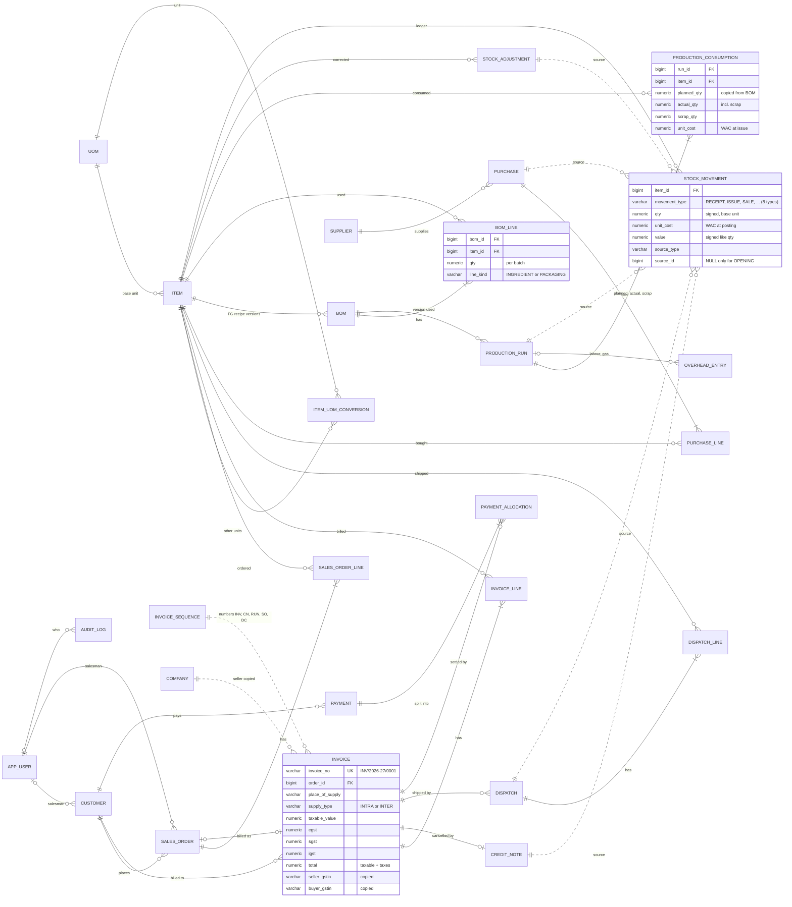

# Design Note: Order-to-Audit System

Spring Boot 4 (Java 21), PostgreSQL 17, React + TypeScript. One database transaction updates stock, production and billing together. Every rule is numbered in [`business-rules.md`](business-rules.md); further detail is in its [section 18](business-rules.md#18-design-note-details).

## 1. Data model



Full ERD with every column, key and status: [PNG](../er-diagram/er-diagram.png), [SVG](../er-diagram/er-diagram.svg). Dotted lines have no foreign key (a movement's `source_type` + `source_id`, numbering, the seller snapshot).

- **One `item` table** for raw materials, packaging and finished goods, so all share **one ledger**. A finished good also carries price, HSN, GST rate and pack weight.
- **Base units.** Quantities are stored in the item's base unit (kg, L, pc, pkt); g, ml and cartons convert at entry.
- **Snapshots.** Orders copy the price, runs the recipe, invoices the parties, HSN and tax, so master edits never rewrite history.
- **No floats:** `NUMERIC` and `BigDecimal`, rounded half-up. The database also enforces the core rules: movement sign, no double posting, invoice totals, gap-free numbers.

## 2. How stock is computed

Stock is a **ledger of movements, never an editable number**:

```
closing = opening + receipts − issues/sales ± adjustments = Σ stock_movement.qty
```

- **No balance table.** Only `InventoryService` writes stock, inserting a `stock_movement` that names its source document. The `stock_balance` view sums the ledger, so a balance cannot drift; average cost is its `stock_value ÷ qty_on_hand`.
- **Locking.** The `item` row is locked (`SELECT … FOR UPDATE`) before the stock check, several items in ascending id order to avoid deadlocks. Stock going negative rolls back the whole document.
- **When stock moves:** purchase (+), production posting (− materials, + finished goods), dispatch (−), credit-note return (+), adjustment (±, with a reason).
- **Reservation at approval.** Approval reserves stock without moving it: `available = on hand − approved or invoiced, not yet dispatched`. Distributor B's 120 against 88 available shows **short by 32** and cannot be fully approved.
- **Append-only:** mistakes are undone by `REVERSAL` movements or credit notes, never edits.

## 3. How BOM consumption is computed

A recipe (BOM) gives each item's standard quantity per batch and the expected yield (`output_qty`, 200 packets). The line kind drives the standard on a run:

| Line kind | Items | Standard quantity on a run |
|---|---|---|
| INGREDIENT | flour, oil, spice | `qty × batches` |
| PACKAGING | pouch, carton | `qty ÷ output_qty × good output` (cartons rounded down to whole cartons) |

So 188 good packets need 188 pouches, not 200. Posting is one transaction: issue everything used (scrap included) and add the good packets, or refuse the run listing every shortage.

```
consumption variance % = (actual incl. scrap − standard) ÷ standard × 100
yield variance %       = (good output − expected output) ÷ expected output × 100
flagged when |variance| > 3.00 %   (company.variance_tolerance_pct)
```

| Benchmark run | Standard | Actual | Variance |
|---|---:|---:|---:|
| Oil | 10 L | 10.5 L | **+5.00 % flagged** |
| Pouch | 188 | 194 (6 damaged) | **+3.19 % flagged** |
| Yield | 200 | 188 | **−6.00 % flagged** |
| Flour, spice, carton | 40 kg, 1.2 kg, 9 | same | 0.00 % |

Balances match the brief: flour 120 kg, oil 19.5 L, pouches 306, finished goods 238 (88 after dispatch). The extra pouch flag exposes packaging wastage.

## 4. Costing and valuation method

**Valuation is weighted average cost (WAC) per item**, recalculated on each receipt:

```
average = (qty on hand × average + qty received × rate) ÷ (qty on hand + qty received)
```

Flour: (100 × 42 + 60 × 45) ÷ 160 = **₹43.125 per kg**. Each issue stores the average at posting, so later purchases never change history. WAC suits bulk flour and oil mixed in one bin and is easy to audit (AS 2 permits it).

**Overheads.** Labour and gas entered on a run are charged to it. Monthly overheads not tied to a run are shared by that month's runs **in proportion to good output in kg**, fair across pack sizes.

```
cost per packet = (materials + packaging incl. damaged + overheads) ÷ good output
```

| Benchmark run | ₹ |
|---|---:|
| Flour 40 × 43.125 + oil 10.5 × 140 + spice 1.2 × 200 | 3,435.00 |
| Pouches 194 × 2.50 + cartons 9 × 15 | 620.00 |
| Labour 1,200 + gas and power 600 | 1,800.00 |
| **Total ÷ 188 good packets** | **5,855.00 → ₹31.14 per packet** |
| Margin against the ₹50 price | ₹18.86 (37.71 %) |

**Trade-off:** finished goods enter stock at material and packaging cost only, because overheads arrive after the run is posted and the ledger is never edited; they appear in the costing report instead, a documented simplification of AS 2 (R13.6).
