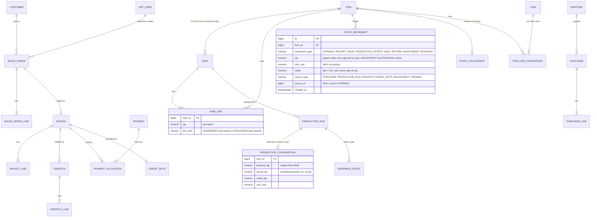

# Design Note — Order-to-Audit System

**Stack:** Spring Boot 4 (Java 21) modular monolith · PostgreSQL 17 with Flyway migrations · React + TypeScript (mobile-first salesman view, desktop admin) · Docker Compose.
A single database transaction can update stock, production and billing together, which is what keeps the books consistent. Full rules and assumptions: [`business-rules.md`](business-rules.md).

## 1. Data model



Design points:
- **One `item` table.** Raw materials, packaging and finished goods (`kind` RAW, PACKAGING, FG) are all rows in `item`, so they share **one ledger**. An FG item also carries the selling price, HSN code, GST rate and pack weight, so there is no separate product table.
- **Snapshots.** Order lines copy the price, and `production_consumption` copies the BOM standard (`planned_qty`). The invoice copies the seller and buyer details, and each invoice line the item name, HSN, price and tax (R10.5). Later master-data edits never rewrite history.
- **Units.** Every item has one base unit (kg, litre, piece, packet). `uom.factor_to_base` converts g→kg and ml→L, and `item_uom_conversion` converts carton→20 packets for that item. Conversion happens at entry, so all stored quantities are in base units.
- **Money and quantity** are `NUMERIC` (qty 14,4; money 14,2; rate 14,4; percentage 5,2) / `BigDecimal`, `HALF_UP`. No floats.
- **Integrity constraints** (the database refuses bad data even if the code is wrong; each has a test in `SchemaAndSeedTest`):
  - `stock_movement`: `sign_matches_type` (sign of `qty` follows the movement type), `value_sign_matches_qty`, and `UNIQUE NULLS NOT DISTINCT (source_type, source_id, item_id, movement_type)` so a document can't be posted twice.
  - `purchase_line`, `dispatch_line`, `invoice_line`: unique per (document, item), so a repeated item is rejected at the line, before it could collide with the movement constraint.
  - `invoice` and `credit_note`: total = taxable + taxes, and CGST/SGST only for intra-state, IGST only for inter-state. A credit note repeats the invoice's tax split.
  - `customer`: GSTIN is 15 characters and starts with the state code. All state codes are `VARCHAR(2)` with `CHECK '^[0-9]{2}$'`.
  - `stock_adjustment`: `reason` is mandatory and not blank.
  - Statuses: `production_run.status` is DRAFT, POSTED, CANCELLED or REVERSED (`posted_has_output` requires output once posted). `purchase.status` and `payment.status` are POSTED or REVERSED with `reversed_at` / `reversed_by`. On all three, `status = 'REVERSED'`, `reversed_at` and `reversed_by` are set together or not at all (`<table>_reversed_state`, `<table>_reversed_by_with_at`). The `invoice_outstanding` view counts only POSTED payments.
  - `audit_log`: the allowed actions include POST, REVERSE, DISPATCH, PAYMENT, LOGIN and LOGIN_FAILED. `user_id` and `entity_id` are nullable (failed login), and `username` is stored.
  - `invoice_sequence`: primary key (`doc_type`, `financial_year`). Invoice, credit-note, production-run, order and dispatch numbers (`INV/2026-27/0001`, and likewise `CN/`, `RUN/`, `SO/`, `DC/`) are gap-free, issued from a counter row locked in the posting transaction.
  - `company.variance_tolerance_pct` (default 3.00) is the variance flag tolerance.

## 2. How stock is computed

Stock is a **ledger of movements, never an editable number**:

```
closing = opening + receipts − issues/sales ± adjustments = Σ(+ movements) − Σ(− movements)
```

- Only `InventoryService` writes stock, by inserting a `stock_movement` linked to its source document. There is **no balance table**: the `stock_balance` view sums the ledger per item, so a balance cannot drift from it. Average cost is `stock_value ÷ qty_on_hand` from the same view. Reading a total means summing the item's movements, which is fine at this factory's volume; a cached table is a later optimisation if reports get slow. The stock summary report checks opening + receipts − issues ± adjustments = closing for every item and refuses to print a report that does not balance; the seeded OPENING rows always count as opening (R15.5).
- **Concurrency:** the `item` row is locked (`SELECT … FOR UPDATE`) before the stock check, since there is no balance row to lock. Multi-item postings lock in ascending item id to avoid deadlocks. A movement that would make stock negative rolls back the whole document.
- **When stock moves:** purchase (+), production posting (− materials, + finished goods), dispatch (−), credit-note return (+), adjustment (±, Admin, reason required). Order approval and invoicing **do not** move stock. Approval only reserves it:
  `available = FG balance − qty on approved/invoiced orders not yet dispatched`. This is how Distributor B's 120-packet order shows **shortage 32** against 88 available and is blocked from approval.
- The ledger is append-only. Mistakes are fixed with `REVERSAL` movements (opposite sign, same source document, so a document can be reversed once), never by editing or by hijacking `ADJUSTMENT`. Posted invoices are cancelled with credit notes. *(Reversal services are planned, not built yet. The schema is ready.)*

Reports (R15) are read-only views over the same tables: one service per report builds a table model, and three
exporters (CSV, Excel, PDF) render any of them. Sales and GST reports read the invoice's own copied details, an
invoice counts in its own month and its credit note negative in the note's month, and outstanding can be shown as
of any past date.

## 3. How BOM consumption is computed

A BOM gives, per batch, each item's standard quantity and the expected yield (`bom.output_qty`, 200 packets). Each line's `line_kind` says what drives its use:

| Driver | Items | Standard quantity on a run |
|---|---|---|
| INGREDIENT | flour, oil, spice | `qty × batches` |
| PACKAGING | pouch, carton | `qty ÷ output_qty × good_output` (cartons: whole cartons, `floor(good ÷ 20)`) |

Packaging is judged against what was actually packed: 188 good packets need 188 pouches, not 200.

**Posting a run** (DRAFT → POSTED, once only, one transaction; a posted run can later become REVERSED, a draft can be CANCELLED): lock the run and its items → check stock → post one `ISSUE` per material for everything issued (used + scrap; the scrap part is kept on `production_consumption.scrap_qty`) → post `PRODUCTION_OUTPUT` for good packets (valued at the total cost of those issues) → store each line's issue cost. If any material is short, the whole post is refused with the full shortage list. Variances and costs are calculated when a run is viewed, not stored. Run numbers (`RUN/2026-27/0001`) come from the per-financial-year counter table.

```
consumption variance % = (used + wasted − standard) ÷ standard × 100
yield variance %       = (good output − expected output) ÷ expected output × 100
flag if |variance| > 3.00 %   (tolerance in company.variance_tolerance_pct)
```

| Benchmark run | Standard | Actual | Variance |
|---|---:|---:|---:|
| Oil | 10 L | 10.5 L | **+5.00 % ⚑** |
| Pouch | 188 | 194 (188 + 6 damaged) | **+3.19 % ⚑** |
| Yield | 200 | 188 | **−6.00 % ⚑** |
| Flour / spice / carton | 40 kg / 1.2 kg / 9 | same | 0.00 % |

Resulting balances: flour **120 kg**, oil **19.5 L**, spice 3.8 kg, pouches **306**, cartons 21, finished goods **238 → 88** after Retailer A's dispatch, all matching the brief. The pouch flag is in addition to the brief's expected flags. It makes the damaged packaging visible, which is the wastage problem the client described.

## 4. Costing and valuation method

**Valuation: weighted average cost (WAC) per item**, recalculated on each receipt:

```
avg = (balance qty × avg + received qty × rate) ÷ (balance qty + received qty)
```

Every outgoing movement stores the average cost at the time of posting, so later purchases never change history. Flour: (100 × 42 + 60 × 45) ÷ 160 = **₹43.125/kg**.
*Why WAC:* flour and oil are bulk stock mixed in the same bin, so lots aren't physically separated. WAC reflects that, smooths price changes, and is simple to audit (AS 2 permits it). FIFO would need lot tracking; last-price would overstate cost while older, cheaper stock is being used.

**Overheads:** labour and gas/power entered against a run are charged to that run. Monthly overheads not tied to a run are allocated to that month's runs **in proportion to good output in kg**, which stays fair when pack sizes differ (e.g. a 500 g pack).

```
cost per packet = (materials + packaging incl. damaged + overheads) ÷ good output
```

| Benchmark run | ₹ |
|---|---:|
| Flour 40 × 43.125 + oil 10.5 × 140 + spice 1.2 × 200 | 3,435.00 |
| Pouches 194 × 2.50 + cartons 9 × 15 | 620.00 |
| Labour 1,200 + gas/power 600 | 1,800.00 |
| **Total ÷ 188 good packets** | **5,855.00 → ₹31.1436 / packet (shown ₹31.14)** |
| Margin vs ₹50 selling price (from the full 31.1436, rounded only for display) | ₹18.8564, shown ₹18.86 = **37.71 %** |

For comparison: FIFO gives ₹30.90 and last price ₹31.54.

**Finished goods are valued at material + packaging only.** Output enters stock at (3,435.00 + 620.00) ÷ 188 = ₹21.5691 per packet. Overheads are not part of stock value because the benchmark adds them after posting (step 8) and the ledger is never edited; they appear in the costing report, which is calculated on request. Opening FG (50 packets) is valued at ₹30.00 (assumption A14), so the FG average after the run is 5,555.00 ÷ 238 ≈ ₹23.34 and dispatches are valued at that average. Trade-off: AS 2 would also put conversion costs in inventory cost. This is a documented simplification, see R13.6.
